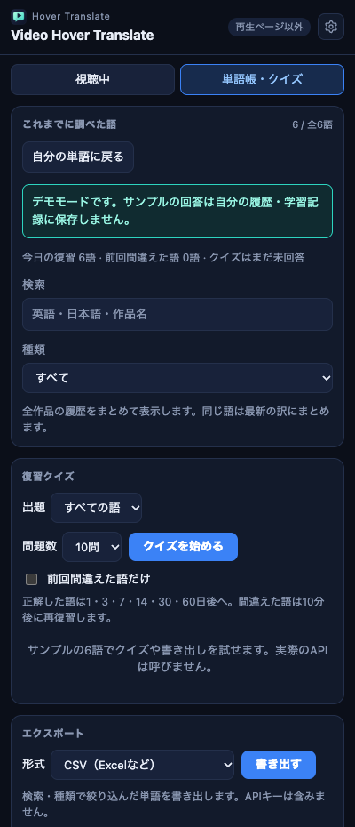
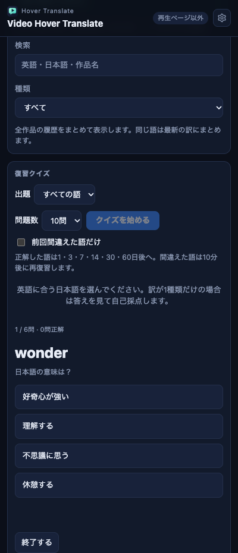

<p align="center"></p>

# Video Hover Translate

**Watch. Discover a word. Remember it.**

Turn English subtitles on Netflix and Disney+ into Japanese vocabulary practice. Hover to translate, collect words, then review them when they are due. Bring your own OpenAI-compatible API or run Ollama locally. No project-operated backend or account is required.

[日本語](README.md) · [Download](https://github.com/yoshimi-I/video-hover-translate/releases/latest) · [Issues](https://github.com/yoshimi-I/video-hover-translate/issues)


## Try it before connecting an API

Install the extension, open its sidepanel, select **単語帳・クイズ → サンプルで試す**. The demo uses six original sample cards. No video, API key, account, or network request is needed. Demo answers never touch your real vocabulary or review history.

<p> </p>

The UI and translation target are currently Japanese. This release is designed for English-to-Japanese learners; the English README makes installation and contribution easier, not a claim of multilingual UI support.

## Features

- Hover English words, idioms, selected spans and sentences for Japanese meanings.
- Optional pause/resume while studying a subtitle.
- A cross-video vocabulary library with search and approximate CEFR levels.
- Multiple-choice quizzes and self-rated cards when history is small.
- **Due review**: correct answers advance through 1, 3, 7, 14, 30 and 60 days; mistakes retry after 10 minutes. Existing counters are preserved. This is a simple fixed-interval schedule, not FSRS.
- CSV, JSON and Anki-compatible two-column TSV exports, without settings or keys.
- Direct OpenAI-compatible APIs, local Ollama, or the existing custom translation API.
- Local history, no project analytics, and explicit per-host permission when saving a new endpoint.

## Install

1. Download and extract the latest release, or clone this repository.
2. Open `chrome://extensions/`, enable Developer mode, and choose **Load unpacked**.
3. Select the folder containing `manifest.json`. No build step is required.
4. Click the extension icon to open the sidepanel. Use the demo, or open settings (gear) to configure translation.
5. Play a Netflix or Disney+ title with **English subtitles** enabled.

For updates, keep the same folder, reload the existing extension, then reload the video tab. Reinstalling from another folder can change the extension ID and its storage. Image-only captions are not supported. This is an unofficial project, independent of the streaming services.

## Translation engines

| Engine | Endpoint example | Setup |
| --- | --- | --- |
| OpenAI-compatible | `https://api.openai.com/v1/chat/completions` | Your API key and a JSON-capable model (default `gpt-4.1-mini`) |
| Ollama | `http://localhost:11434/v1/chat/completions` | Run Ollama and install a model (default `qwen3:8b`); no key |
| Custom API | `https://<host>/<stage>/translate` | An existing server implementing [this contract](docs/API.md) |

Save settings, grant access to the configured host, and press **保存済みの設定で接続テスト**. Model availability and compatible API behavior vary by provider. No API credentials are included, and a ChatGPT subscription does not supply an OpenAI API key.

For Ollama, install a model (`ollama pull qwen3:8b`) and start the server if it is not already running. If the server rejects the extension origin, configure `OLLAMA_ORIGINS` for `chrome-extension://<extension-id>` and restart the server according to your OS/service setup. See [Ollama compatibility](https://docs.ollama.com/api/openai-compatibility). Performance and JSON reliability depend on your model and hardware. An Ollama server configured to use a cloud model may forward data to that provider.

When translation is enabled, each detected subtitle cue can trigger a request, even before you hover. Cloud providers may charge for requests. Quizzes, exports and sample demo run locally. See [privacy details](PRIVACY.md).

## Data and limitations

Recent lookup events are retained up to 2,000 entries. The library groups repeated words and displays the latest meaning. JSON exports include vocabulary and review metadata; there is no import UI yet. Anki TSV contains two plain-text fields; disable HTML interpretation when importing. CSV uses UTF-8 BOM and spreadsheet-formula protection.

Selectors depend on private player markup. Synthetic tests help catch regressions but cannot guarantee compatibility with every current title/player. Diagnostic output helps distinguish connection, subtitle and API errors. Do not submit private keys or viewing history in issues.

## Develop

Node.js 22+ and Chrome are needed for local browser tests. `zip` is required for packaging on macOS/Linux.

```sh
npm ci
npm run check
npm test
npm run pack
```

On Linux or without Chrome: `npx playwright install --with-deps chromium`, then `CI=1 npm test`.

`npm run icons` regenerates PNGs from the editable [SVG](icons/icon.svg). `npm run screenshots` renders screenshots using original demo data. Source files are executable JavaScript; the original distribution did not include its upstream TypeScript build environment. New providers and learning features are separate dependency-free modules.

Contributions are welcome: see [CONTRIBUTING.md](CONTRIBUTING.md), [API contract](docs/API.md), and the [product rationale](docs/PRODUCT.md).

## License

Project code: [MIT](LICENSE). Vocabulary data and bundled libraries retain separate licenses; see [THIRD_PARTY_NOTICES.md](THIRD_PARTY_NOTICES.md). Release archives include those notices. No streaming-service footage, full subtitle datasets, personal history, or credentials are distributed.
