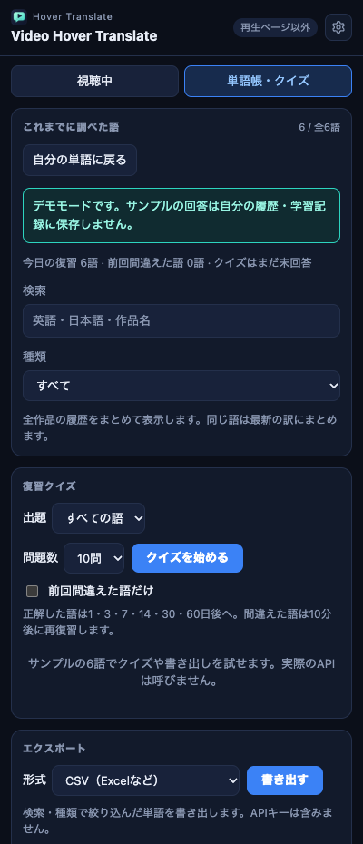
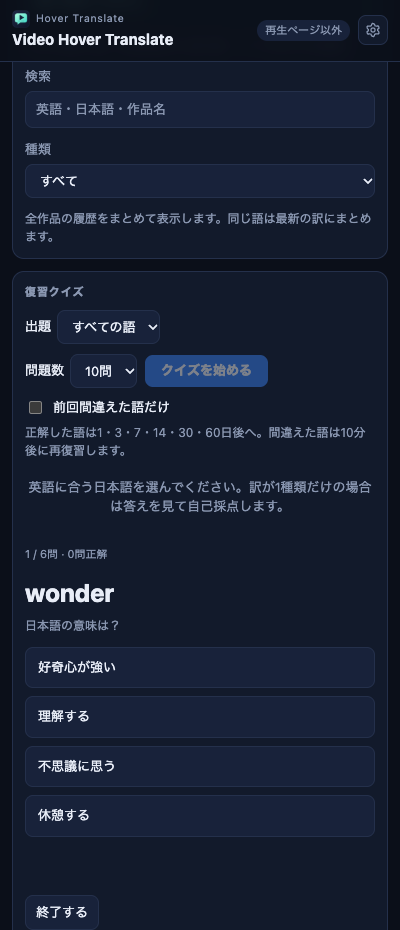

<p align="center"></p>

# Video Hover Translate

**Watch. Discover a word. Remember it.**

[English](README.en.md) · [Download](https://github.com/yoshimi-I/video-hover-translate/releases/latest) · [Report a bug](https://github.com/yoshimi-I/video-hover-translate/issues)


Netflix・Disney+の英語字幕にマウスを合わせて日本語訳を表示する、Chrome Manifest V3拡張です。調べた単語をためて、動画を閉じたあともクイズで復習できます。

## キーなしで試す

拡張をインストールして、サイドパネルの「単語帳・クイズ」→「サンプルで試す」を押してください。動画・アカウント・APIキーなしで単語帳、クイズ、書き出しを試せます。サンプルの回答は実際の履歴に保存せず、ネットワーク通信も行いません。

<p> </p>

*スクリーンショットはプロジェクト独自のサンプル例文です。配信サービスの映像・字幕や利用者の履歴は含みません。*

## できること

- 字幕の単語・熟語・選択範囲・文の翻訳
- ホバー中の一時停止と再開、CEFRレベルの目安表示
- 全作品で調べた語をまとめる単語帳、英語・日本語・作品名検索
- 最大4択の復習クイズ（5・10・20問）、正誤記録、前回間違えた語の復習
- 復習期限を管理する「今日の復習」
- OpenAI互換API・ローカルのOllama・従来のカスタムAPIの切り替え
- CSV、JSON、Anki用TSVのエクスポート
- ページ接続・字幕取得・API設定の診断

## インストール・更新

1. このリポジトリをダウンロードまたはcloneします。
2. Chromeで `chrome://extensions/` を開き、デベロッパーモードを有効にします。
3. 「パッケージ化されていない拡張機能を読み込む」で `manifest.json` のあるフォルダーを指定します。実行用のnpmインストールやビルドは不要です。
4. 拡張アイコンからサイドパネルを開き、歯車から翻訳APIのURL・キーを保存します。
5. Netflix / Disney+で英語字幕を有効にして作品を再生します。

**更新時は同じフォルダーのまま拡張を再読み込みし、動画のタブも再読み込みしてください。** アンインストールや別フォルダーからの再インストールでは拡張IDや保存領域が変わり、履歴を引き継げない場合があります。

Netflix / Disney+とは独立した非公式プロジェクトです。画像だけで配信される字幕は読み取れません。各サービスの画面変更で字幕の検出に影響が出る場合があります。

## 翻訳エンジンを選ぶ

専用AWSサーバーは不要です。設定画面で次から選び、保存後に「接続テスト」を押します。既存ユーザーのカスタムAPI設定はそのまま使えます。

| エンジン | 接続先の例 | キー | 必要な準備 |
| --- | --- | --- | --- |
| OpenAI互換API | `https://api.openai.com/v1/chat/completions` | 各自のAPIキー | Chat CompletionsとJSON出力に対応するモデル（初期値 `gpt-4.1-mini`） |
| Ollama | `http://localhost:11434/v1/chat/completions` | 不要 | Ollamaの起動とモデルの導入（初期値 `qwen3:8b`） |
| カスタム翻訳API | `https://<host>/<stage>/translate` | 各自のキー | [互換API](docs/API.md) のサーバー |

モデル名や利用できるサービスは各自のアカウント・サーバーに合わせて変更してください。OpenAI互換を名乗るすべてのAPIでの動作は保証しません。`response_format: {type: "json_object"}` と必要なJSON応答に対応する必要があります。

新しい接続先は「保存」を押したときに、そのホストだけChromeのアクセス許可を求めます。HTTPは `localhost` と `127.0.0.1` に限定します。エンジンを変更すると別サービスへ古いキーを送らないよう入力を切り替えます。

### Ollamaの例

```sh
ollama pull qwen3:8b
ollama serve
```

すでにOllamaのアプリやサービスが動いている場合、追加の `ollama serve` は不要です。接続が拒否される場合は、Ollamaの `OLLAMA_ORIGINS` にこの拡張のオリジン `chrome-extension://<拡張ID>` を許可してサーバーを再起動してください。設定方法はOS・起動方法により異なります。[公式ドキュメント](https://docs.ollama.com/api/openai-compatibility) を参照してください。

ローカルモデルの速度・JSON出力品質はハードウェアとモデルによります。モデル導入や実際の翻訳品質は自分の環境で接続テストしてください。クラウドモデルをOllama側で選べば、そのサーバーからクラウドへ送られる場合があります。

**翻訳を有効にすると字幕ごとにAPIへ要求します。** クラウドAPIは課金・レート制限の対象になり得ます。接続テストも短い例文を1回送信します。共有キーは配布しません。ChatGPT等のサブスクリプションとは別に、利用先でAPIを準備してください。

既存履歴の復習・書き出し・サンプルデモはAPI通信なしで動きます。

## 単語帳・クイズ

「単語帳・クイズ」から使います。字幕の訳を実際に開いた語を対象に、全作品の保存済み履歴をまとめます。同じ種類・同じ英語は最新の訳にまとめ、調べた回数を表示します。元の履歴は直近2,000件までのため、それ以前に上限から外れた履歴は復元できません。

クイズは検索と種類の絞り込みを反映し、セッション中は同じカードを重複出題しません。訳が2～3種類しかなければ選択肢も減り、1種類だけなら答えを見て「覚えていた／まだ覚えていない」で自己採点します。正誤はローカルに保存し、「前回間違えた語だけ」で復習できます。誤答の選択肢は過去の日本語訳を使うため、文脈によって別の選択肢も意味的に成立する場合があります。

### 今日の復習

出題を「今日の復習」にすると、未回答と復習期限の来た語だけ出題します。正解は連続正解数に応じて1・3・7・14・30・60日後に、誤答は10分後に予定します。旧バージョンの正誤記録は保持し、期限未設定の語を復習対象にします。

これはシンプルな固定間隔のスケジュールです。FSRS / Anki互換スケジューラーではなく、学習効果を保証するものでもありません。

## エクスポート

検索と種類で絞り込んだ単語が対象です。

- **CSV**: UTF-8 BOM付き。英語、日本語、種類、例文、作品、調べた回数、日時、クイズの回答数・正解数・次回復習日時。表計算ソフトの数式として実行されそうな文字列には先頭にアポストロフィを付けます。
- **JSON**: バージョン付きの単語・学習記録。APIキーや設定を含みません。現時点でインポート機能はありません。
- **Anki TSV**: 英語・日本語の2列。Ankiで「基本」ノートにタブ区切りで取り込んでください。改行は空白に変換し、HTMLとして扱わない設定で使います。

## データとプライバシー

[PRIVACY.md](PRIVACY.md) に保存先と外部送信内容を記載しています。学習履歴はChromeのローカル保存領域に残ります。エクスポートには例文や作品名を含むため、ファイルを共有する前に内容をご確認ください。

## 開発

Node.js 22以上が必要です。ZIP作成にはmacOS / Linuxの `zip` コマンドを使います。macOSではインストール済みのGoogle Chromeでブラウザーテストを実行します。

```sh
npm ci
npm run check
npm test
npm run pack
# SVGからアイコンを再生成: npm run icons
# サンプル画面を再撮影: npm run screenshots
```

LinuxやChromeを入れていない環境では、PlaywrightのChromiumを使います。

```sh
npx playwright install --with-deps chromium
CI=1 npm test
```

`npm run pack` は配布に必要なファイルとライセンスを `dist/video-hover-translate-<version>.zip` にまとめます。学習履歴・API設定・node_modules・テスト用データは含めません。

```text
providers.js           接続先設定・OpenAI互換/Ollamaの翻訳アダプター
content.js             字幕検出・表示・動画操作
sw.js                  翻訳API・キャッシュ・履歴保存（Zod同梱）
sidepanel.js           視聴中の集計・設定（Lucide同梱）
study-core.js          履歴の集約、クイズ、エクスポートの純粋関数
study-store.js         複数ウィンドウの回答を直列に保存
study-ui.js            単語帳・クイズの画面制御
sidepanel.html/.css    サイドパネル
data/vocab-levels.js  語彙レベルデータ（別ライセンス）
tests/                 単体・ブラウザーの回帰テスト
```

初期のコードはビルド済みZIPを起点にしており、元のTypeScriptソース・ビルド環境は含まれていません。現在の実行可能なJavaScriptをソースとして管理し、追加機能は依存のないモジュールに分けています。

## ライセンス

プロジェクトコードは [MIT](LICENSE)。語彙データ・同梱ライブラリには別の条件があります。[THIRD_PARTY_NOTICES.md](THIRD_PARTY_NOTICES.md) と `licenses/` を確認してください。NetflixやDisney+の映像・字幕そのものを配布するプロジェクトではありません。
